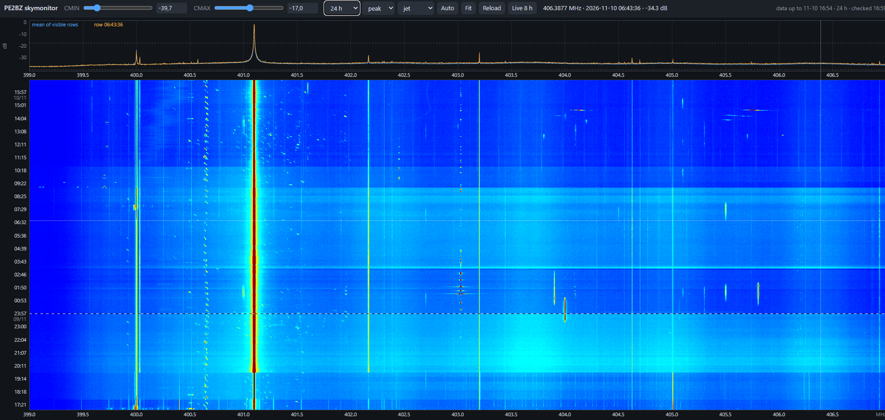

# skymonitor-waterfall

Interactive browser waterfalls for an `rtl_power` sky monitor, for example the
400–406 MHz radiosonde band, by Ben Zandstra, PE2BZ.

* **waterfall.html**: the last few hours, refreshed every 5 minutes.
* **waterfall_history.html**: several days of history, built from hourly tiles,
  so only a small amount of data is uploaded every 5 minutes.

Both viewers run entirely in the browser (plain HTML + JavaScript, no server
code). Features:

* CMIN/CMAX level sliders and four colour maps (jet, viridis, inferno, grey), remembered per browser
* zoom with the mouse wheel (Shift = frequency only, Alt = time only), drag to pan, pinch on phones
* double-click, `f` or `0` to fit everything; `+` / `-` to zoom
* readout of frequency, time and level under the cursor
* spectrum panel (mean of the visible rows plus the row under the cursor)
* frequency axis above and below the waterfall
* history viewer: span 8 h / 24 h / 2 days / 3 days, midnight lines,
  arrow keys and PgUp/PgDn to scroll through time, **peak/mean** choice for zoomed-out views

## How it works

```
rtl_power ──> record.sh ──> daily CSV files (rtl_power_YYYY-MM-DD.csv)
                                 │
         ┌───────────────────────┴───────────────────────┐
  upload_live.sh (cron, 5 min)                  upload_history.sh (cron, 5 min)
  skymon_data.py                                skymon_tiles.py
  rtl_power_data.png + .json                    tiles/sky_YYYYMMDD_HH.png + skymon_index.json
         │                                               │
  waterfall.html                                waterfall_history.html
```

The levels are stored as 8-bit grey values (0.25 dB per step) in PNG files, so
the browser can recolour and rescale them instantly without new downloads.

## Requirements

* Linux with `rtl_power` (rtl-sdr), `curl`, `flock`
* Python 3 with `numpy` and `pillow`: `pip3 install numpy pillow`
* a web space that accepts FTPS uploads (or just view it locally, see below)

## Setup

```
git clone https://github.com/<you>/skymonitor-waterfall.git ~/skymonitor-waterfall
cd ~/skymonitor-waterfall
cp config.example.sh config.sh      # then edit config.sh
chmod +x *.sh
```

1. **Record.** Edit the frequency range, gain and ppm in `record.sh` and start it
   (for example from a systemd service or `@reboot` in cron). It writes one CSV
   per day to `CSV_DIR`.
2. **Test without uploading:**
   ```
   NO_UPLOAD=1 ./upload_live.sh; NO_UPLOAD=1 ./upload_history.sh; tail -5 ~/skymon_web/upload_*.log
   ```
3. **Upload the two HTML pages once** to the folder `FTP_DIR` on your web space.
4. **Add the cron jobs:**
   ```
   */5 * * * * $HOME/skymonitor-waterfall/upload_live.sh
   */5 * * * * $HOME/skymonitor-waterfall/upload_history.sh
   ```

Your FTP login goes in `~/.netrc` (`chmod 600`), never in the scripts.

### Viewing locally (no web space)

Copy the two HTML files into `OUT_DIR` and serve that folder:

```
cp waterfall*.html ~/skymon_web/; cd ~/skymon_web && python3 -m http.server 8090
```

Then open `http://<this-machine>:8090/waterfall.html` or `waterfall_history.html`.

## Notes

* The history tiles use one fixed dB scale for all hours (`DB_OFFSET`, default −50 dB,
  covering −50 … +13.75 dB). Adjust it if your levels sit elsewhere.
* Old tiles are never deleted automatically, locally or on the server; clean up when you want to.
* Times are the local time of the recording machine, as written by `rtl_power`.

## extras/skymon_sweep.py

A wideband sweeper for a **LimeSDR** (via SoapySDR) that writes the same CSV format,
for bands wider than one receiver bandwidth (tested on 2180–2290 MHz in ~12–20 MHz hops).
The output works with `skymon_tiles.py` and `waterfall_history.html`; use a lower
`--offset` (for example −80) because its levels are in dBFS per bin.

## Credits

The idea of a continuous `rtl_power` sky monitor comes from Mark Jessop, VK5QI.
His original PNG waterfall scripts are not part of this repository.

## Licence

MIT, see `LICENSE`.
